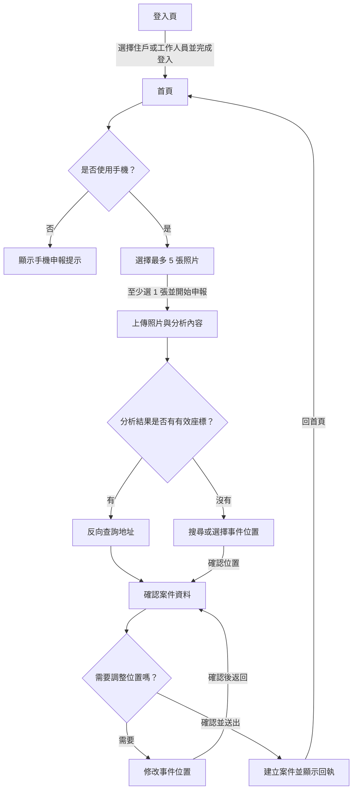

# 社區小尖兵：目前成果與社區事件申報流程

## 專案目前完成進度

目前已完成前端主要頁面、行動版介面，以及和後端 API 的呼叫流程：

- **登入與入口**：提供住戶／工作人員身分選擇，並可導向 LINE 登入後端；成功回到網站後保留登入角色，首頁會檢查登入狀態。
- **首頁與 AI 對話**：提供社區服務入口、申報事件連結、地點與天氣資訊，以及串流 AI 對話。對話可附加圖片；語音輸入由瀏覽器轉成文字。
- **社區資訊**：提供事件總覽、案件列表、我的申報事件、在地活動及地點查詢等頁面。
- **事件申報**：已串接照片上傳、AI 分析、地點搜尋／反向查詢、案件建立及完成回執的前端流程；詳細步驟見下文。
- **介面與素材**：已整理共用字體與樣式、行動版登入版面，並將多項圖片素材轉為 WebP。

這個儲存庫提供前端。天氣、聊天、登入、事件清單、地點、照片分析／上傳及案件建立都需要相容的後端 API；地圖畫面另需設定 `GOOGLE_MAPS_API_KEY`。登入入口需設定 `LINE_LOGIN_PATH`。目前申報入口預設只讓手機進入，桌機預覽設定為關閉。

## 申報流程圖

## 頁面與操作

### 1. 登入與首頁

- 使用者選擇「住戶」或「工作人員」後，前端依 `LINE_LOGIN_PATH` 導向登入服務；後端完成 OAuth 後導回登入頁，前端保存登入角色並進入首頁。
- 首頁要求有登入狀態。登入角色保存在瀏覽器 `localStorage`，供前端判斷導頁；需要權限的 API 仍須由後端驗證伺服器端登入狀態。
- 手機使用者從「申報社區事件」服務卡片進入 `pages/report/report.html`。桌機首頁會隱藏此入口；直接開啟申報頁也會看到手機申報提示。`allowDesktopReportPreview` 預設為 `false`。

### 2. `report.html`：選擇照片

- 使用者可拍攝或從相簿選擇圖片，最多 5 張；可預覽並移除照片。
- 至少選擇 1 張後才能開始申報。
- 照片暫存在 IndexedDB，開始後前往 `status-text-animation.html`。

### 3. `status-text-animation.html`：上傳與分析

- 前端將照片送至 `POST /uploads`，並在後端提供實際傳輸進度時顯示百分比；同時將照片轉成 data URL，送至 `POST /ai-analyze` 取得案件類別、描述及可能的座標。
- 若已有成功的分析或上傳資料，重試會沿用草稿中已保存的結果，避免不必要的重傳。
- 分析結果有有效座標時，呼叫 `GET /places/reverse` 取得地址後前往案件確認頁。反向查詢失敗時會保留座標文字並繼續。
- 沒有有效座標時，前往 `location-recognition.html` 補選位置。
- 上傳或分析失敗會顯示錯誤及重試按鈕；使用者可重試或返回重新選取照片。

### 4. `location-recognition.html`：補選事件位置

- 顯示本次申報照片，使用者可搜尋地址／地標、選擇搜尋結果，或使用手機目前位置。
- 設定 Google Maps API Key 並成功載入地圖時，也可點選地圖、拖曳標記或使用微調按鈕調整座標。
- 選擇位置後，前端呼叫 `GET /places/reverse` 確認地址。確認位置後前往 `report-review.html`。
- 地圖需要 `GOOGLE_MAPS_API_KEY`；地點搜尋與反向查詢需要後端 `/places` API。未載入地圖時，仍可使用搜尋及手機定位功能。

### 5. `report-review.html`：確認案件資料與送出

- 顯示 AI 分析得到的案件類別、案件描述及事件位置。案件類別目前唯讀；案件描述可修改，且至少需要 10 個字。
- 使用者可前往 `location-edit.html` 修改位置；確認後回到同一份案件草稿。
- 點擊「確認並送出」後，前端呼叫 `POST /cases` 建立案件，送出期間會停用按鈕；成功需由後端回傳 `cases_id` 才會進入完成頁。
- 目前送出的案件資料包含類別、描述、上傳附件路徑及 `author_account`。`address` 欄位目前傳送座標字串；完成頁顯示的地址則取自申報草稿中的位置資料。
- 送出失敗會顯示原因並允許重試。若後端已建立案件但回應在途中遺失，前端無法單靠此頁判斷是否已建立，需以後端案件狀態確認後再操作。

### 6. `location-edit.html`：修改事件位置

- 以草稿目前位置作為初始位置，操作方式與補選位置頁相同：可搜尋、使用手機定位，或透過地圖調整。
- 確認新位置後更新同一份申報草稿並返回 `report-review.html`。

### 7. `report-complete.html`：顯示申報結果

- 成功建立案件後顯示後端回傳的案件編號，以及草稿中的位置、類別和描述。
- 若沒有成功建立案件的回執資料，頁面會顯示找不到案件資料的提示。
- 使用者可點擊「回首頁」返回首頁。

## 草稿與資料延續

- 照片檔案暫存於 IndexedDB（`community-report`）；申報分析、上傳路徑、位置、修改後描述及建立結果暫存於目前分頁的 `sessionStorage`。
- 跨申報頁跳轉時會沿用同一份草稿；照片成功送案後會嘗試清除 IndexedDB 中的照片。
- `sessionStorage` 的草稿限目前瀏覽器分頁工作階段使用，並非伺服器保存的案件資料。

## 主要 API 對照

| API | 申報流程中的用途 |
| --- | --- |
| `POST /uploads` | 上傳申報照片並取得附件路徑 |
| `POST /ai-analyze` | 分析照片，取得案件類別、描述及可能的位置座標 |
| `GET /places?q=...` | 搜尋地址或地標 |
| `GET /places/reverse?lat=...&lng=...` | 以座標查詢地址 |
| `POST /cases` | 建立社區事件案件 |

## 目前需要的外部設定

- `API_BASE_URL`：相容的後端 API 網址；`API_USE_PROXY=true` 時透過 Vite `/api` 代理。
- `LINE_LOGIN_PATH`：後端 LINE OAuth 登入入口。
- `GOOGLE_MAPS_API_KEY`：地圖顯示與地圖操作所需的瀏覽器端金鑰。
- `MOCK_AUTHOR_ACCOUNT`：目前前端申報及「我的申報事件」查詢使用的作者帳號設定。

設定方式與其餘 API 功能請參考 [README.md](README.md)。
