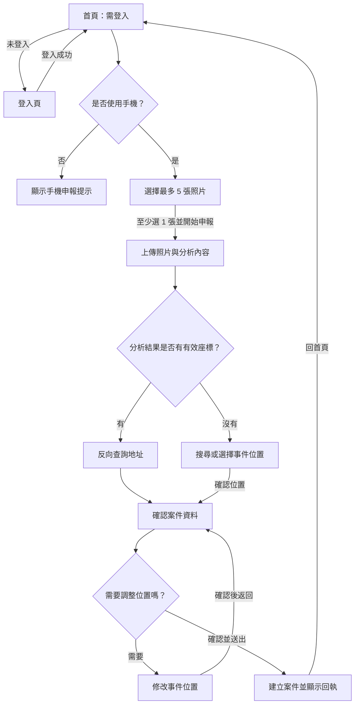

# 社區小尖兵：目前成果與社區事件申報流程

## 專案目前完成進度

目前已完成前端主要頁面、行動版介面，以及和後端 API 的呼叫流程：

- **登入與入口**：未登入時進入首頁會導向登入頁；申報上傳、建立案件與查看「我的申報」需要 LINE 登入 session。
- **首頁與 AI 對話**：提供社區服務入口、申報事件連結、地點與天氣資訊，以及串流 AI 對話。對話可附加圖片；圖片先送照片分析 API，語音錄音送語音轉文字 API。
- **福利與在地資訊查詢**：可輸入問題或錄音轉成文字，並設定查詢地點後查看後端提供的福利與活動資訊。
- **社區資訊**：提供事件總覽、案件列表、我的申報事件、在地活動及地點查詢等頁面。
- **事件申報**：已串接照片上傳、AI 分析、地點搜尋／反向查詢、案件建立及完成回執的前端流程；詳細步驟見下文。
- **介面與素材**：已整理共用字體與樣式、行動版登入版面，並將多項圖片素材轉為 WebP。

這個儲存庫提供前端。天氣、聊天、登入、事件清單、福利資訊、地點、照片分析／上傳、語音轉文字及案件操作都需要相容的後端 API。前端從後端 `/api/runtime-config.js` 讀取 LINE 登入路徑與 Google Maps 瀏覽器金鑰；API 根網址由 `.env` 的 `API_BASE_URL` 設定。目前申報入口預設只讓手機進入，桌機預覽設定為關閉。

## 申報流程圖

## 頁面與操作

### 1. 登入與首頁

- 網站預設開啟首頁；未登入時會導向登入頁。首頁不提供登入或登出入口；登入頁依住戶或工作人員身分導向後端 LINE OAuth。
- 申報照片上傳、建立案件及查看「我的申報」需要有效 session。未登入時前端導向登入頁，登入成功後返回原頁；後端仍須驗證 session 權限。
- 手機使用者從「申報社區事件」服務卡片進入 `pages/report/report.html`。桌機首頁會隱藏此入口；直接開啟申報頁也會看到手機申報提示。`allowDesktopReportPreview` 預設為 `false`。

### 2. `report.html`：選擇照片

- 使用者可拍攝或從相簿選擇圖片，最多 5 張；可預覽並移除照片。
- 至少選擇 1 張後才能開始申報。
- 照片暫存在 IndexedDB，開始後前往 `status-text-animation.html`。

### 3. `status-text-animation.html`：上傳與分析

- 前端將照片送至 `POST /uploads`，並在後端提供實際傳輸進度時顯示百分比；同時將照片轉成 data URL，送至 `POST /ai-analyze` 取得案件類別、描述及可能的座標，再以 `GET /categories` 核對類別。
- 若已有成功的分析或上傳資料，重試會沿用草稿中已保存的結果，避免不必要的重傳。
- 分析結果有有效座標時，呼叫 `GET /places/reverse` 取得地址後前往案件確認頁。反向查詢失敗時會保留座標文字並繼續。
- 沒有有效座標時，前往 `location-recognition.html` 補選位置。
- 上傳或分析失敗會顯示錯誤及重試按鈕；使用者可重試或返回重新選取照片。

### 4. `location-recognition.html`：補選事件位置

- 顯示本次申報照片，使用者可搜尋地址／地標、選擇搜尋結果，或使用手機目前位置。
- 設定 Google Maps API Key 並成功載入地圖時，也可點選地圖、拖曳標記或使用微調按鈕調整座標。
- 選擇位置後，前端呼叫 `GET /places/reverse` 確認地址。確認位置後前往 `report-review.html`。
- 地圖需要 `GOOGLE_MAPS_API_KEY`；地點搜尋與反向查詢需要後端 `/places` API。未載入地圖時，仍可使用搜尋及手機定位功能。

### 5. `report-review.html`：確認案件資料與送出

- 顯示 AI 分析得到的案件類別、案件描述及事件位置。案件類別目前唯讀；案件描述可修改，且至少需要 10 個字。
- 點擊麥克風可錄製案件描述，再將錄音檔送至 `POST /transcribe`；辨識文字會附加到描述供使用者編輯。瀏覽器不支援錄音或麥克風權限失敗時會顯示提示。
- 使用者可前往 `location-edit.html` 修改位置；確認後回到同一份案件草稿。
- 點擊「確認並送出」後，前端呼叫 `POST /cases` 建立案件，送出期間會停用按鈕；成功需由後端回傳 `cases_id` 才會進入完成頁。
- 送出的案件資料包含 `category_id`、`description`、`images` 附件路徑及確認後的 `address`；作者由登入 session 決定。完成頁顯示後端回傳的案件編號及草稿中的位置、類別和描述。
- 送出失敗會顯示原因並允許重試。若後端已建立案件但回應在途中遺失，前端無法單靠此頁判斷是否已建立，需以後端案件狀態確認後再操作。

### 6. `location-edit.html`：修改事件位置

- 以草稿目前位置作為初始位置，操作方式與補選位置頁相同：可搜尋、使用手機定位，或透過地圖調整。
- 確認新位置後更新同一份申報草稿並返回 `report-review.html`。

### 7. `report-complete.html`：顯示申報結果

- 成功建立案件後顯示後端回傳的案件編號，以及草稿中的位置、類別和描述。
- 若沒有成功建立案件的回執資料，頁面會顯示找不到案件資料的提示。
- 使用者可點擊「回首頁」返回首頁。

## 草稿與資料延續

- 照片檔案暫存於 IndexedDB（`community-report`）；申報分析、上傳路徑、位置、修改後描述及建立結果暫存於目前分頁的 `sessionStorage`。
- 跨申報頁跳轉時會沿用同一份草稿；照片成功送案後會嘗試清除 IndexedDB 中的照片。
- `sessionStorage` 的草稿限目前瀏覽器分頁工作階段使用，並非伺服器保存的案件資料。

## 主要 API 對照

| API | 申報流程中的用途 |
| --- | --- |
| `POST /uploads` | 上傳申報照片並取得附件路徑 |
| `POST /ai-analyze` | 分析照片，取得案件類別、描述及可能的位置座標 |
| `GET /places?q=...` | 搜尋地址或地標 |
| `GET /places/reverse?lat=...&lng=...` | 以座標查詢地址 |
| `POST /cases` | 建立社區事件案件（由登入 session 決定作者） |

首頁及聊天頁的語音輸入會以 multipart `file`、`language` 欄位呼叫 `POST /transcribe`。聊天附圖會先呼叫 `POST /ai-analyze`，再把辨識摘要連同對話送至 `POST /chat/stream`；串流端點回傳 404 或 405 時改用 `POST /chat`。

## 目前需要的外部設定

- `API_BASE_URL`：相容的後端 API 根網址；本機 Vite 會將 `/api` 和 `/uploads` 請求代理至該主機。
- 後端 runtime config：提供 `lineLoginPath` 與 `googleMapsApiKey`；案件作者與權限由後端登入 session 決定。

設定方式與其餘 API 功能請參考 [README.md](README.md)。
