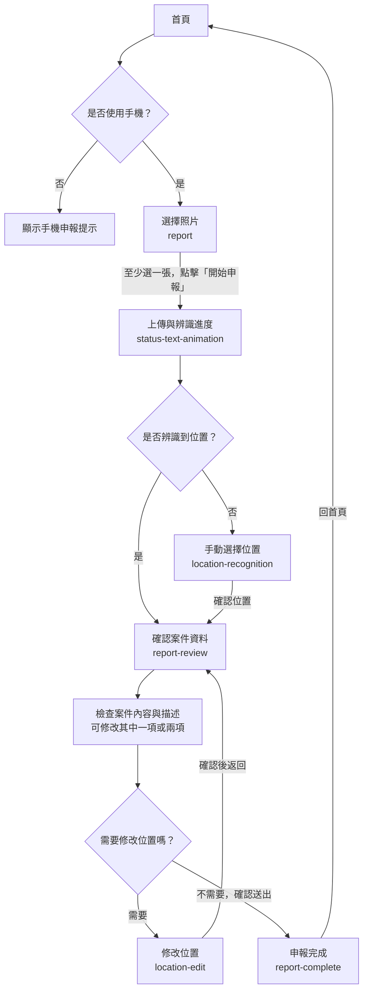

# 社區事件申報操作流程

## 流程目標

使用者以手機從首頁選擇「申報社區事件」，上傳事件照片，確認辨識結果與位置後送出申報，最後看到申報完成資料。桌機使用者不能進入申報流程，首頁會提示改用手機，因為手機定位較適合確認事件的實際位置。

本文件記錄討論確認的預期流程。首頁原型位於 `preview/index.html`；申報流程頁位於 `preview/pages/report/`。

## 流程圖

## 頁面與操作

### 1. 首頁：選擇申報服務

- 手機使用者點擊「申報社區事件」service 卡片後，進入 `report`。
- 正式流程中，桌機首頁以提示取代申報入口，申報流程各頁也會顯示手機申報提示。
- 桌機預覽開關 `allowDesktopReportPreview` 目前為停用；桌機會顯示手機申報提示，申報流程頁也會阻擋進入。
- 首頁其他服務、事件總覽、文字輸入區與我的申報事件不屬於本次申報主流程；它們可各自有獨立互動。

### 2. `report`：選擇照片

- 使用者可拍照或從相簿選取照片。
- 顯示已選照片的預覽，並允許移除不需要的照片。
- 至少選擇一張照片後，「開始申報」才可操作。
- 點擊「開始申報」後，照片進入上傳與辨識流程，前往 `status-text-animation`。

### 3. `status-text-animation`：上傳與辨識

- 顯示照片上傳及內容、位置辨識的處理狀態。
- 有實際上傳進度時才顯示百分比；等待辨識時以狀態文字或不定進度呈現，不虛構百分比。
- 辨識完成後依位置結果分流：
  - **有辨識到位置**：直接前往 `report-review`。
  - **沒有辨識到位置**：前往 `location-recognition`，由使用者補選位置。
- 上傳或辨識失敗時顯示原因與重試方式。重試應沿用同一份申報草稿，避免重複建立附件或申報。

### 4. `location-recognition`：補選事件位置

- 僅在系統沒有辨識到位置，或流程需要使用者補選位置時出現。
- 顯示已選取的申報照片，讓使用者搜尋地址／地標，或在地圖上選擇事件位置。
- 使用者必須選定位置並確認，才能前往 `report-review`。
- 地圖載入失敗時，仍應提供手動輸入地址或重試方式。

### 5. `report-review`：確認與修改案件資料

- 顯示辨識或手動選擇得到的案件內容、案件描述與事件位置。
- 使用者可分別修改案件內容、案件描述，或兩者都修改；修改並套用後仍留在本頁。
- 使用者可檢查位置；若位置不正確，進入 `location-edit`。
- 送出前檢查必要欄位。資料有缺漏時留在本頁，指出需要補充的欄位。
- 資料確認完成後，使用者點擊「確認並送出」進入申報送出狀態；避免重複送出。

### 6. `location-edit`：修改事件位置

- 從 `report-review` 開啟，並以目前草稿的位置作為初始位置。
- 使用者可搜尋地址／地標，或在地圖上點選、拖曳標記及微調位置。
- 使用者確認新位置後，回到同一份 `report-review` 草稿；更新後的位置顯示於案件資料中。

### 7. `report-complete`：顯示申報結果

- 申報送出成功後顯示完成狀態及後端回傳的案件編號、位置與案件資料。
- 正式案件編號與回執資料由後端提供，不由前端自行產生。
- 使用者點擊「回首頁」返回首頁。

## 主要資料在流程中的延續

同一份申報草稿會跨頁保留以下資料，供後續確認、修改及送出：

- 已選照片及上傳後的附件資料。
- 辨識得到的案件內容與案件描述，以及使用者修改後的內容。
- 辨識得到或使用者選擇、修改後的位置。
- 申報草稿狀態與送出結果。

照片、案件文字與地址不應只靠頁面網址傳遞。從位置編輯頁返回時，必須回到原本的草稿與案件確認資料。

## 原型目前狀態

目前靜態 HTML 原型提供導覽預覽模式，讓人檢查頁面跳轉；照片上傳、辨識、搜尋、地圖調整、案件修改與實際送出都已停用：

- 首頁 service 卡片已連到 `report`。
- `report` 的「開始申報」前往 `status-text-animation`；辨識預覽頁可選擇「位置未辨識」前往 `location-recognition`，或選擇「位置已辨識」直接前往 `report-review`。
- `location-recognition` 的確認連結前往 `report-review`；案件內容與描述為唯讀。
- `report-review` 可前往 `location-edit`，位置頁的返回連結會回到 `report-review`。
- `report-review` 的預覽連結前往 `report-complete`，不會建立或送出申報；完成頁可返回首頁。

